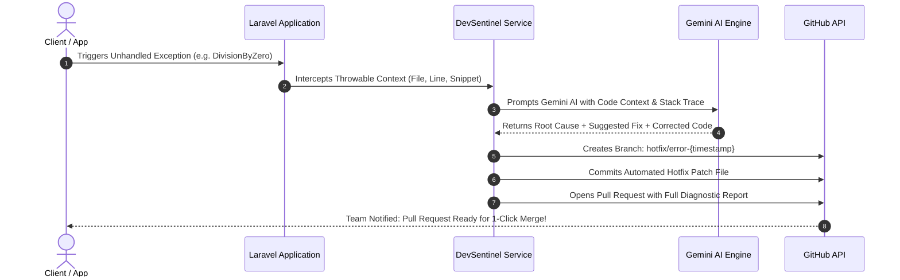

<div align="center">

# 🛡️ DevSentinel (AI-Driven Self-Healing Engine)
### Automated Production Error Triage & Auto-PR Hotfix Engine for Laravel 11

[](https://laravel.com)
[](https://php.net)
[](https://ai.google.dev)
[](https://github.com)

<p align="center">
  <b>DevSentinel intercepts production exceptions in real-time, captures execution context & code snippets, consults Google Gemini AI asynchronously, and automatically generates Hotfix branches with Pull Requests on GitHub.</b>
</p>

</div>

---

## ⚡ The Problem It Solves

When an unhandled exception or 500 error crashes a production application at 2:00 AM:
1. **Traditional Flow:** The user sees a crash, logs pile up, developers spend hours in the morning reading stack traces, locating lines, writing patches, and manually opening Pull Requests.
2. **The DevSentinel Flow:** 
   - Intercepts the exception before application termination.
   - Harvests the exact stack trace, failing file, and surrounding 10 lines of code context.
   - Sends the sanitized context to **Google Gemini AI**.
   - Gemini diagnoses the root cause and generates the exact fixed code.
   - DevSentinel calls the **GitHub REST API** to automatically branch, commit the patch report, and **open a Hotfix Pull Request with proposed code ready for human review**.

---

## 🏗️ Architecture Flow



---

## 🚀 Live Demonstration

Run the synthetic error trigger command in terminal:

```bash
php artisan sentinel:test
```

### Console Output:
```text
⚡ Triggering a synthetic runtime error...
Caught exception: Division by zero
🤖 Contacting Gemini AI for diagnosis...
✅ AI Diagnosis successfully received!
Root Cause: The error occurs because the variable $divisor is being assigned the value of an undefined variable $undefinedRate using the null coalescing operator, defaulting to 0. Attempting to divide the number 1000 by 0 triggers a PHP DivisionByZeroError.
Suggested Fix: Ensure the divisor cannot be zero by providing a non-zero default value or checking the divisor before performing the division.

🚀 Dispatching automated Hotfix to GitHub...

==========================================================
🎉 SUCCESS: GitHub Hotfix Pull Request Automatically Created!
👉 PR URL: https://github.com/sufyanahmad1-png/devsentinel/pull/1
👉 Branch: hotfix/error-1794505138
==========================================================
```

---

## 📂 Project Structure

```
app/
├── Console/
│   └── Commands/
│       └── TestSentinelCommand.php    # Artisan command to demonstrate end-to-end triage
├── Services/
│   ├── DevSentinelService.php         # Intercepts stack trace & communicates with Gemini AI
│   └── GitHubPatchService.php         # Orchestrates GitHub API branches, commits, & PRs
```

---

## 🛠️ Installation & Setup

1. **Clone the repository:**
   ```bash
   git clone https://github.com/sufyanahmad1-png/devsentinel.git
   cd devsentinel
   ```

2. **Install Dependencies:**
   ```bash
   composer install
   ```

3. **Configure Environment (.env):**
   ```env
   GEMINI_API_KEY=your_gemini_api_key
   GITHUB_TOKEN=your_github_personal_access_token
   GITHUB_REPO_OWNER=sufyanahmad1-png
   GITHUB_REPO_NAME=devsentinel
   ```

4. **Run Live Test:**
   ```bash
   php artisan sentinel:test
   ```

---

## 👨‍💻 Developed By
**Sufyan Ahmad**  
Full Stack Laravel Developer | BSCS Undergraduate  
[LinkedIn Profile](https://linkedin.com/in/sufyan-ahmed-861389377) • [GitHub Profile](https://github.com/sufyanahmad1-png)
